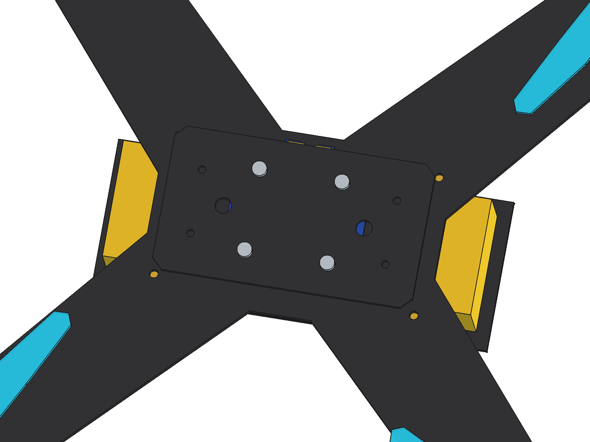

# 300mm 轴距对接无人机 (Machinable Docking UAV 300) 3D 模型文档 (Mateksys 统一连续电气堆叠配置)

本项目包含可实际机加工、具备物理对接接口的 300mm 轴距四旋翼无人机完整三维 CAD 模型。

---

## 1. 核心模型交付文件

* **FreeCAD 原生工程**：[`Machinable_Docking_UAV_300.FCStd`](./Machinable_Docking_UAV_300.FCStd)（426 KB）
  * 包含 18 个独立的 `PartDesign::Body` 原生参数化特征树，保留全部草图与尺寸约束，支持随时二次调整。
* **通用 STEP 工业模型**：[`Machinable_Docking_UAV_300.step`](./Machinable_Docking_UAV_300.step)（812 KB，含 20,129 个精密几何图元）
  * 适用于 SolidWorks、Fusion 360、CATIA、NX、AutoCAD 等工业 CAD 导入，以及 MuJoCo、Gazebo 仿真物理网格提取。
* **参数化生成脚本**：[`../scripts/build_machinable_uav_300.py`](../scripts/build_machinable_uav_300.py)
  * 基于 FreeCAD / CADPilot 结构化 RPC 工具编写，支持一键无损复现与参数调整。

---

## 2. 渲染视图与检查截图

| 轴测全景视图 | 侧面剖视图（3mm/8mm 铜柱垂直连续堆叠特写） | Mateksys FCHUB-12S V2 精细分电板俯视图 | 飞控底板与锁固螺母特写 |
| :---: | :---: | :---: | :---: |
|  |  |  |  |

---

## 3. 核心改进与统一中心塔电气堆叠结构 (Unified Continuous Stack)

针对用户关于“飞控底板连接机架”及“3mm 铜柱撑分电板、8mm 铜柱撑飞控”的明确要求，本版本彻底统一了中心塔动力与飞控安装轴线，**所有力流通过标准 $30.5 \times 30.5\text{ mm}$ M3 铜柱轴心自底向上直接锁入机身主碳纤底板**，消除了所有悬空与中间隔离板问题：

```
                    ┌───────────────────────────────┐
                    │  CUAV Pixhawk V6X (Z=17.6~46.8)│
                    └───────────────┬───────────────┘
                                    │ 72x24mm 固定
                    ┌───────────────┴───────────────┐
                    │  飞控碳纤底板 (96x54mm, T=2mm) │ <--- 4x M3 螺母锁紧 (Z=17.6~20.0)
                    └───────────────┬───────────────┘
                                    │
                       8mm 高度 M3 铜柱 (Z=7.6~15.6mm)
                                    │
          ┌─────────────────────────┴─────────────────────────┐
          │ Mateksys FCHUB-12S V2 分电板 (50x50+5mm, Z=6.0~7.6)│
          └─────────────────────────┬─────────────────────────┘
                                    │
                       3mm 高度 M3 铜柱 (Z=3.0~6.0mm)
                                    │
    ════════════════════════════════╪════════════════════════════════ 主机身底板 (Z=0~3mm)
                                    │
                      30mm 高度 M3 铜柱 (Z=-30~0mm)
                                    │
    ────────────────────────────────┴──────────────────────────────── 电池碳纤底板 (Z=-32~-30mm)
                    ┌───────────────────────────────┐
                    │     4S LiPo 动力电池 (Z=-29.5~-0.5)     │
                    └───────────────────────────────┘
```

---

## 4. 结构组件与关键工程参数 (全部 18 个实体，100% Valid Solids)

1. **下机身一体化碳纤维底板 (`Body_Bottom_Perimeter_Frame`)**：
   * **厚度**：3.0 mm（碳纤维板 CNC 铣削）
   * **机臂边长/宽度**：**32.0 mm**（对角线中心线法向全宽 32mm），连接 4 处电机座与外围保护框
   * **电机安装孔**：标准 $16.0 \times 16.0\text{ mm}$ 4-M3 孔位布局（边缘留有 $>3.0\text{ mm}$ 碳纤维安全裕度）
   * **中心舱底面**：长 $106.0\text{ mm} \times$ 宽 $68.0\text{ mm}$
   * **中心孔位**：**$30.5 \times 30.5\text{ mm}$ 标准 4-M3 穿孔**（直接固定 3mm 铜柱），外侧配备 4 处电池铜柱孔（$96 \times 52\text{ mm}$）
   * **实体体积**：$161,808.74\text{ mm}^3$（`is_valid: true`）

2. **3mm 分电板支撑铜柱 (`Body_PDB_Standoffs_3mm`)**：
   * **规格**：4 根 M3 黄铜立柱，外径 $\Phi 5.0\text{ mm}$，高度 **$3.0\text{ mm}$**
   * **安装孔距**：**$30.5 \times 30.5\text{ mm}$**（坐标 $\pm 15.25, \pm 15.25\text{ mm}$）
   * **垂直区间**：$Z = 3.0 \sim 6.0\text{ mm}$，坚固支撑分电板
   * **实体体积**：$235.62\text{ mm}^3$（`is_valid: true`）

3. **Mateksys FCHUB-12S V2 分电板 (`Body_Mateksys_PDB`)**：
   * **本体外形**：$50.0 \times 50.0\text{ mm}$（R4 圆角），上方突出 **$+5.0\text{ mm}$** DC-IN 动力焊盘凸耳（总高 $55.0\text{ mm}$）
   * **板厚与材质**：$1.6\text{ mm}$ 标准 FR-4 蓝油沉金板（Mateksys 经典深蓝 `[0.08, 0.25, 0.65]`）
   * **安装孔位**：$30.5 \times 30.5\text{ mm}$ 标准 4-M3 安装孔
   * **垂直区间**：$Z = 6.0 \sim 7.6\text{ mm}$
   * **实体体积**：$4,041.81\text{ mm}^3$（`is_valid: true`）

4. **分电板沉金焊盘与电源汇流排 (`Body_PDB_Copper_Pads`)**：
   * **包含特征**：顶部主电源端子（+/- 分流沉金大焊盘）、中央动力大铜排、4 角 ESC 动力/信号焊盘、4 处 M3 螺栓孔接地环
   * **厚度**：$0.25\text{ mm}$（$Z = 7.60 \sim 7.85\text{ mm}$，亮金色 `[0.90, 0.72, 0.20]`）
   * **实体体积**：$56.92\text{ mm}^3$（`is_valid: true`）

5. **分电板真实贴片电子器件 (`Body_PDB_Components`)**：
   * **包含器件**：2 只 $10 \times 10 \times 4\text{ mm}$ 一体成型大功率屏蔽电感（"100"）、2 只大电流采样分流电阻（"0m30" 与 "0m50"）、JST-GH 排线插座
   * **垂直区间**：$Z = 7.60 \sim 11.40\text{ mm}$（工业深灰 `[0.28, 0.30, 0.32]`）
   * **实体体积**：$951.82\text{ mm}^3$（`is_valid: true`）

6. **8mm 飞控支撑铜柱 (`Body_FC_Standoffs_8mm`)**：
   * **规格**：4 根 M3 黄铜立柱，外径 $\Phi 5.0\text{ mm}$，高度 **$8.0\text{ mm}$**
   * **安装孔距**：**$30.5 \times 30.5\text{ mm}$**（坐标 $\pm 15.25, \pm 15.25\text{ mm}$）
   * **垂直区间**：$Z = 7.60 \sim 15.60\text{ mm}$，避开贴片器件并承托飞控底板
   * **实体体积**：$628.32\text{ mm}^3$（`is_valid: true`）

7. **飞控碳纤底板 (`Body_FC_Plate`)**：
   * **尺寸**：$96.0 \times 54.0 \times 2.0\text{ mm}$，倒角碳纤维板
   * **安装孔**：
     * 中心 **$30.5 \times 30.5\text{ mm}$** 4-M3 孔（完全对准 8mm 铜柱直接锁紧）
     * 外侧 **$72.0 \times 24.0\text{ mm}$** 4-M2.5/M3 孔（CUAV Pixhawk V6X 标准安装规格）
   * **垂直区间**：$Z = 15.60 \sim 17.60\text{ mm}$
   * **实体体积**：$10,077.30\text{ mm}^3$（`is_valid: true`）

8. **飞控底板 M3 紧固螺母 (`Body_FC_Mount_Nuts`)**：
   * **规格**：4 只标准 M3 锁紧螺母（对边 $5.5\text{ mm}$，高 $2.4\text{ mm}$，镍银色）
   * **垂直区间**：$Z = 17.60 \sim 20.00\text{ mm}$，直观展现机械锁定结构
   * **实体体积**：$228.08\text{ mm}^3$（`is_valid: true`）

9. **CUAV Pixhawk V6X 飞控系统 (`Body_Pixhawk_V6X`)**：
   * **主体尺寸**：底座 $85.1 \times 45.0 \times 12.5\text{ mm}$，上方 IMU 减震内胆 $38.65 \times 31.65 \times 16.7\text{ mm}$（总厚 $29.2\text{ mm}$）
   * **垂直区间**：$Z = 17.60 \sim 46.80\text{ mm}$（距顶框留有 **$6.2\text{ mm}$** 充裕安全避让空隙）
   * **实体体积**：$68,297.40\text{ mm}^3$（`is_valid: true`）

10. **下挂电池 30mm 铜柱 (`Body_Battery_Standoffs`)**：
    * 4 根 M3 铜柱（$\Phi 5.0\text{ mm}$，高 $30.0\text{ mm}$），孔距 $96.0 \times 52.0\text{ mm}$，区间 $Z = -30.0 \sim 0.0\text{ mm}$
    * **实体体积**：$2,356.19\text{ mm}^3$（`is_valid: true`）

11. **电池托板 (`Body_Battery_Plate`)**：
    * $146.0 \times 56.0 \times 2.0\text{ mm}$ 碳纤板，带双向魔术带穿线槽，区间 $Z = -32.0 \sim -30.0\text{ mm}$
    * **实体体积**：$16,187.13\text{ mm}^3$（`is_valid: true`）

12. **4S 动力电池 (`Body_Battery_4S`)**：
    * $136.0 \times 43.5 \times 29.0\text{ mm}$ 1500mAh 锂电池，区间 $Z = -29.5 \sim -0.5\text{ mm}$
    * **实体体积**：$171,564.00\text{ mm}^3$（`is_valid: true`）

13. **动力系统与外围保护框架**：
    * **电机定子与线圈 (`Body_F60_Stators`)**：4 组，体积 $20,693.02\text{ mm}^3$
    * **电机 5 辐转子 (`Body_F60_Rotors`)**：4 组，体积 $12,873.87\text{ mm}^3$
    * **Gemfan 51477 桨叶 (`Body_Props_51477`)**：4 组，体积 $23,626.95\text{ mm}^3$
    * **外围立柱 (`Body_Standoffs`)**：8 根铝合金柱（高 $50\text{ mm}$），体积 $11,309.73\text{ mm}^3$
    * **顶层保护框 (`Body_Top_Perimeter_Frame`)**：$370 \times 370 \times 2.0\text{ mm}$，体积 $40,007.19\text{ mm}^3$
    * **外围对接卡扣 (`Body_Docking_Mechanism`)**：体积 $5,607.74\text{ mm}^3$

---

## 5. 校验总结

* **实体总数**：18 个独立的 `PartDesign::Body`，全部为原生特征拉伸。
* **几何拓扑有效性**：**18/18 实体通过 OpenCASCADE `isValid() == True` 严格校验**。
* **物理连续性**：底板 $\to$ 3mm 铜柱 $\to$ Mateksys PDB $\to$ 8mm 铜柱 $\to$ 飞控底板 $\to$ 螺母 $\to$ Pixhawk V6X 全部紧密贴合并在同一 $30.5 \times 30.5\text{ mm}$ 轴线上锁死，无任何悬空或干涉。
