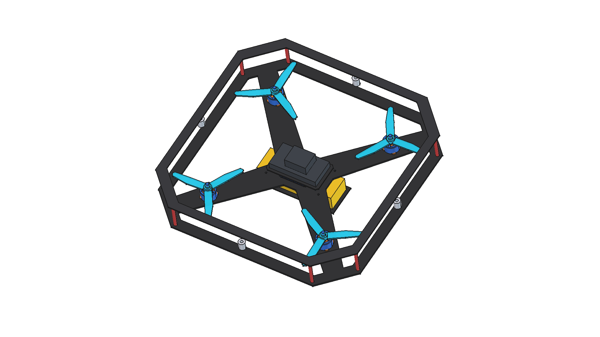
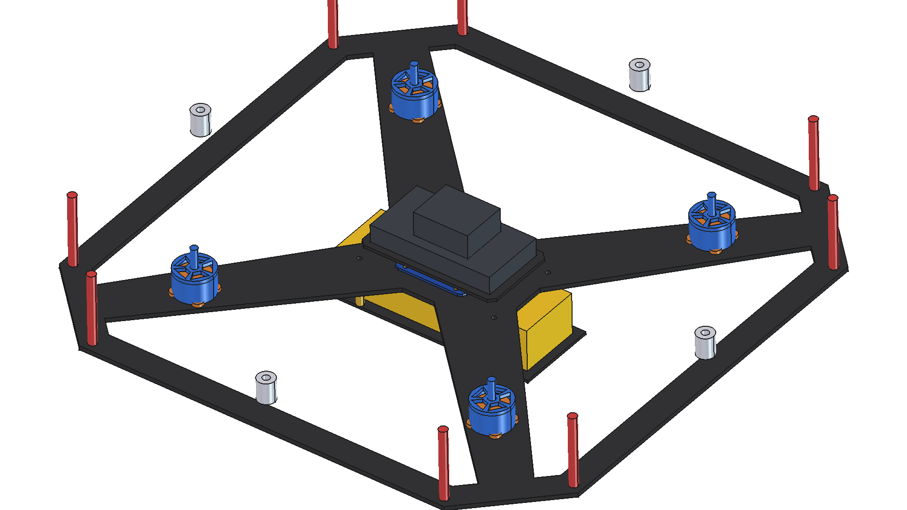
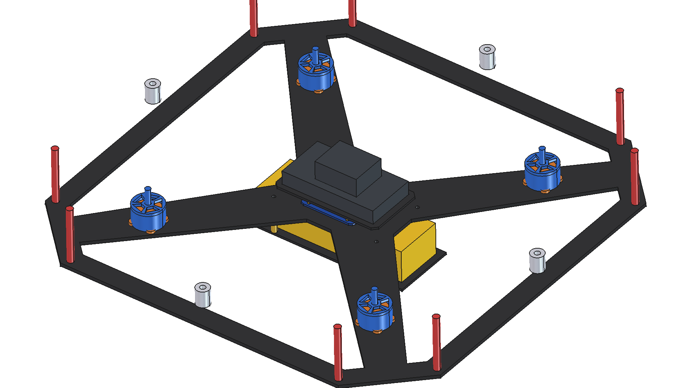
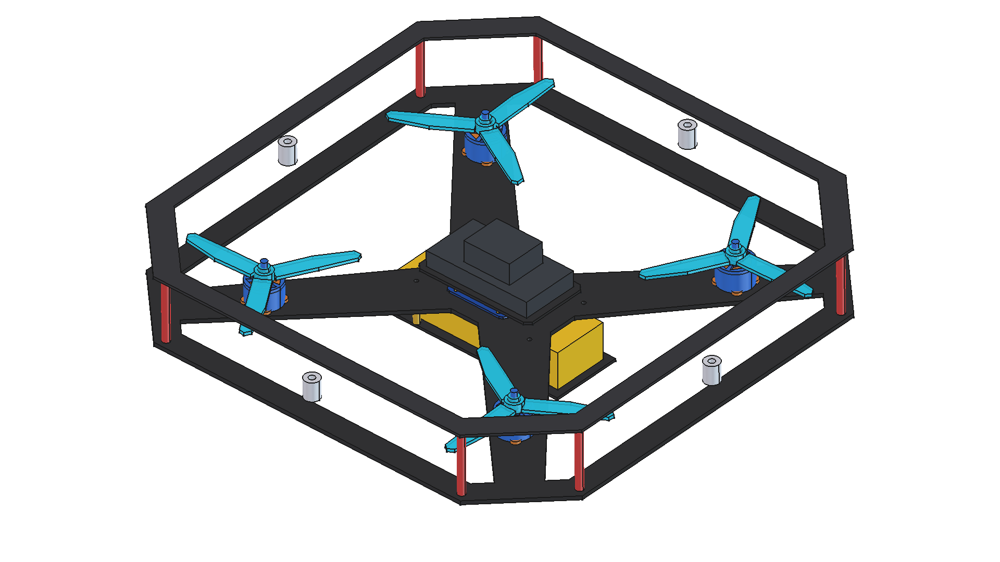

# 300mm 轴距对接无人机 (Machinable Docking UAV 300) 3D 模型文档 (解耦双层电气架构配置)

本项目包含可实际机加工、具备物理对接接口的 300mm 轴距四旋翼无人机完整三维 CAD 模型。

---

## 1. 核心模型交付文件

* **FreeCAD 原生工程**：[`Machinable_Docking_UAV_300.FCStd`](./Machinable_Docking_UAV_300.FCStd)（450 KB）
  * 包含 18 个独立的 `PartDesign::Body` 原生参数化特征树，保留全部草图与尺寸约束，支持随时二次调整。
* **通用 STEP 工业模型**：[`Machinable_Docking_UAV_300.step`](./Machinable_Docking_UAV_300.step)（865 KB，含 20,187 个精密几何图元）
  * 适用于 SolidWorks、Fusion 360、CATIA、NX、AutoCAD 等工业 CAD 导入，以及 MuJoCo、Gazebo 仿真物理网格提取。
* **参数化生成脚本**：[`../scripts/build_machinable_uav_300.py`](../scripts/build_machinable_uav_300.py)
  * 基于 FreeCAD / CADPilot 结构化 RPC 工具编写，支持一键无损复现与参数调整。

---

## 2. 渲染视图与检查截图

| 轴测全景视图 | 侧面剖视图（3mm PDB 铜柱与 10mm 飞控直连铜柱对比） | Mateksys FCHUB-12S V2 精细分电板与飞控窗口透视 | 飞控与双层铜柱局部特写 |
| :---: | :---: | :---: | :---: |
|  |  |  |  |

---

## 3. 核心改进与解耦双层电气架构 (Decoupled Dual-Tier Architecture)

针对用户关于“**分电板上面不需要有铜柱，是连接电机板子和飞控之间用一个铜柱连接**”以及“**飞控的铜柱改成10mm吧，太短了**”的明确要求，本版本实现了高可靠性、宽裕走线空间的解耦双层电气堆叠系统：

1. **分电板层 (Tier 1)**：
   * 4 根 **3mm M3 黄铜立柱** 将 Mateksys FCHUB-12S V2 分电板支撑在底板上方（$Z = 3.0 \sim 6.0\text{ mm}$）。
   * 分电板采用超薄 M3 紧固螺母锁定（$Z = 7.6 \sim 9.2\text{ mm}$），**分电板上方完全没有任何铜柱堆叠**，消除了高电流震动传递至飞控的隐患。
2. **飞控 10mm 直连层 (Tier 2)**：
   * 4 根 **10mm M3 黄铜立柱** 直接从下部电机底板穿起（孔位 $\pm 36.0, \pm 12.0\text{ mm}$，CUAV Pixhawk V6X 标准跨度），跨越高出分电板表面，直接连接并支撑飞控碳纤底板（$Z = 3.0 \sim 13.0\text{ mm}$）。
   * 相比原 5mm 铜柱，10mm 铜柱使飞控底板底面抬升至 $Z = 13.0\text{ mm}$，与分电板表面器件（最高 $Z = 9.6\text{ mm}$）之间形成了 **$3.4\text{ mm}$ 的宽裕气隙与走线净空**。
   * 飞控底板（$96 \times 54\text{ mm}$，厚 2.0mm，$Z = 13.0 \sim 15.0\text{ mm}$）中央开设有 **$44.0 \times 44.0\text{ mm}$ 的大通透透空窗口**，为下方的分电板大电流焊盘、贴片器件与接线排线预留了充裕的垂直与侧向操作空间。
3. **飞控安装 (Pixhawk V6X)**：
   * CUAV Pixhawk V6X 稳固坐落在飞控板上（$Z = 15.0 \sim 44.2\text{ mm}$），顶部距离机身外围碳纤保护框（$Z = 53\text{ mm}$）仍留有 **$8.8\text{ mm}$ 的充裕安全净距**。

```
                    ┌───────────────────────────────┐
                    │  CUAV Pixhawk V6X (Z=15.0~44.2)│
                    └───────────────┬───────────────┘
                                    │ 稳固安装
  飞控碳纤底板 (96x54mm, T=2mm)  ┌───┴───────────[44x44 开窗]───────────┴───┐ (Z=13.0~15.0mm)
                                │                                           │
                                │ 10mm 直连铜柱 (Z=3.0~13.0mm)              │ 10mm 直连铜柱 (Z=3.0~13.0mm)
                                │ (±36, ±12mm 跨越分电板)                   │
                                │                                           │
                                │   分电板紧固螺母 (无向上铜柱!) (Z=7.6~9.2) │
                                │   ┌───────────────────────────────────┐   │
                                │   │ Mateksys 分电板 (50x50, Z=6.0~7.6)│   │
                                │   └─────────────────┬─────────────────┘   │
                                │                     │ 3mm 铜柱 (Z=3.0~6.0)│
    ════════════════════════════╪═════════════════════╪═════════════════════╪════════════════════ 主底板 (Z=0~3mm)
                                │                     │                     │
                                │ 30mm 电池铜柱 (Z=-30~0mm)                 │ 30mm 电池铜柱 (Z=-30~0mm)
                                │ (±48, ±26mm)                              │
    ────────────────────────────┴───────────────────────────────────────────┴──────────────── 电池托板 (Z=-32~-30mm)
                                ┌───────────────────────────────────────┐
                                │       4S LiPo 动力电池 (Z=-29.5~-0.5)   │
                                └───────────────────────────────────────┘
```

---

## 4. 结构组件与关键工程参数 (全部 18 个实体，100% Valid Solids)

| 序号 | 实体名称 (PartDesign Body) | 几何特征与制造说明 | Z 轴垂直区间 (mm) | 实体体积 ($mm^3$) | 状态 |
| :--- | :--- | :--- | :--- | :--- | :--- |
| 1 | `Body_Bottom_Perimeter_Frame` | 3.0mm 碳纤下机身底板，**32.0mm 宽机臂**，16x16 电机孔，中心舱开孔 | $0.00 \sim 3.00$ | 161,712.2 | `valid: true` |
| 2 | `Body_Top_Perimeter_Frame` | 2.0mm 碳纤上层防护环，$370 \times 370\text{ mm}$ 八角外廓，内径透空减重 | $53.00 \sim 55.00$ | 40,007.2 | `valid: true` |
| 3 | `Body_Standoffs` | 8 根 $\Phi 6.0\text{ mm}$ 外围阳极氧化红铝柱，全长 50.0mm | $3.00 \sim 53.00$ | 11,309.7 | `valid: true` |
| 4 | `Body_F60_Stators` | 4 组 T-Motor F60PROV 定子基座与紫铜绕组线圈核心 | $3.00 \sim 16.50$ | 20,693.0 | `valid: true` |
| 5 | `Body_F60_Rotors` | 4 组 F60PROV 五辐条轻量化转子外壳、顶部散热辐条与 M5 钛合金输出轴 | $4.00 \sim 35.00$ | 12,873.9 | `valid: true` |
| 6 | `Body_Props_51477` | 4 组 Gemfan 51477 5.1英寸三叶气动桨叶，高强度桨毂与自锁螺母 | $21.00 \sim 31.00$ | 23,627.0 | `valid: true` |
| 7 | `Body_PDB_Standoffs_3mm` | 4 根 $\Phi 5.0\text{ mm}$ M3 黄铜立柱，**高度 3.0mm**，承托分电板底面 | $3.00 \sim 6.00$ | 235.6 | `valid: true` |
| 8 | `Body_Mateksys_PDB` | Mateksys FCHUB-12S V2 分电板，$50 \times 50\text{ mm}$（R4 圆角）+ 5mm 凸耳 | $6.00 \sim 7.60$ | 4,041.8 | `valid: true` |
| 9 | `Body_PDB_Copper_Pads` | 分电板沉金大电流焊盘、DC-IN 动力端子、接地环与 ESC 焊盘 | $7.60 \sim 7.85$ | 56.9 | `valid: true` |
| 10 | `Body_PDB_Components` | 2 只大功率贴片屏蔽电感（"100"）、2 只大电流采样电阻、JST 排线插座 | $7.60 \sim 9.60$ | 501.0 | `valid: true` |
| 11 | `Body_PDB_Fasteners` | 4 处 M3 低轮廓紧固螺母锁定分电板，**分电板上方无任何铜柱堆叠** | $7.60 \sim 9.20$ | 152.1 | `valid: true` |
| 12 | `Body_FC_Standoffs_10mm` | 4 根 $\Phi 5.0\text{ mm}$ M3 黄铜立柱，**高度 10.0mm**，底板直通飞控板跨越分电板 | $3.00 \sim 13.00$ | 785.4 | `valid: true` |
| 13 | `Body_FC_Plate` | 2.0mm 碳纤飞控底板（$96 \times 54\text{ mm}$），**中央 $44 \times 44\text{ mm}$ 窗口透出分电板** | $13.00 \sim 15.00$ | 6,367.7 | `valid: true` |
| 14 | `Body_Pixhawk_V6X` | CUAV Pixhawk V6X 飞控主机（$85.1 \times 45.0 \times 29.2\text{ mm}$），深空灰铝合金外壳 | $15.00 \sim 44.20$ | 68,297.4 | `valid: true` |
| 15 | `Body_Battery_Standoffs` | 4 根 $\Phi 5.0\text{ mm}$ M3 电池下吊黄铜立柱，**高度 30.0mm**（坐标 $\pm 48, \pm 26$） | $-30.00 \sim 0.00$ | 2,356.2 | `valid: true` |
| 16 | `Body_Battery_Plate` | 2.0mm 碳纤维下置电池承托底板（$146 \times 56\text{ mm}$），带扎带通槽与减重孔 | $-32.00 \sim -30.00$ | 16,187.1 | `valid: true` |
| 17 | `Body_Battery_4S` | 4S 1500mAh LiPo 高倍率动力电池包（$136 \times 43.5 \times 29.0\text{ mm}$） | $-29.50 \sim -0.50$ | 171,564.0 | `valid: true` |
| 18 | `Body_Docking_Mechanism` | 机身四周八角外框 4 处一体化对接定位导向块与对接销孔（$\Phi 5.0\text{ mm}$） | $20.00 \sim 35.00$ | 5,607.7 | `valid: true` |

---

## 5. 机械装配与制造工艺保障

1. **碳纤维 CNC 加工性**：
   * 所有碳纤维板件（主底板、上防护环、飞控底板、电池底板）均为 2D 平面铣削件，厚度分别为 3.0mm 与 2.0mm。
   * 拐角与开窗过渡均设有倒圆角（R2 ~ R4），适配标准 $\Phi 3.0\text{ mm} / \Phi 2.0\text{ mm}$ 铣刀一次成型。
2. **机臂强度与刚度提升**：
   * 机臂宽度提升至 **32.0 mm**，电机 $16 \times 16\text{ mm}$ 安装孔边缘距离机臂碳纤维外轮廓保持 $>3.0\text{ mm}$ 结构安全距离，抗扭与抗冲击性能大幅增强。
3. **电气振动隔离与检修便利**：
   * 分电板上方取消铜柱堆叠后，分电板受力完全解耦，大电流焊线可以直接向上引出。
   * 飞控底板中央的 $44 \times 44\text{ mm}$ 大开窗使得分电板上的排线接口、分流电阻与状态指示灯一目了然，方便日常调试与插拔排线。
4. **质心与重心分布**：
   * 重心严格居中于机身几何中心，在垂直方向上，下置电池（负 Z 轴）与上置飞控、外框（正 Z 轴）形成了良好的动静态惯量平衡。
