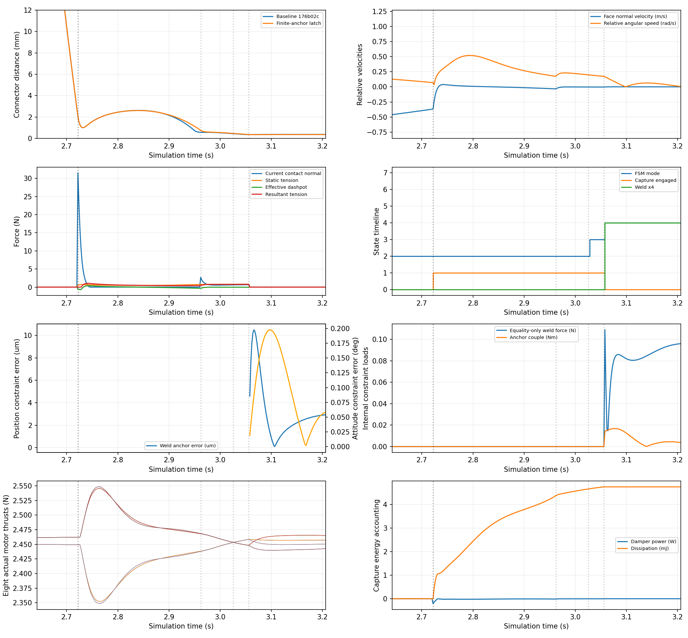
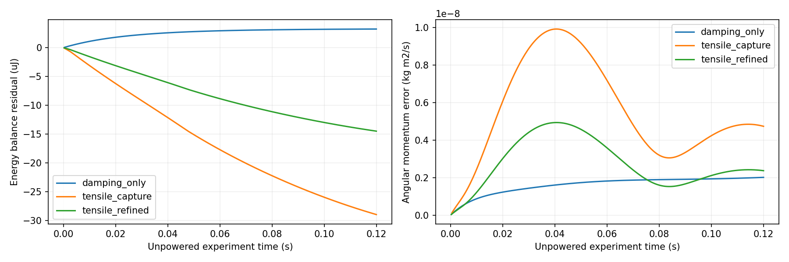
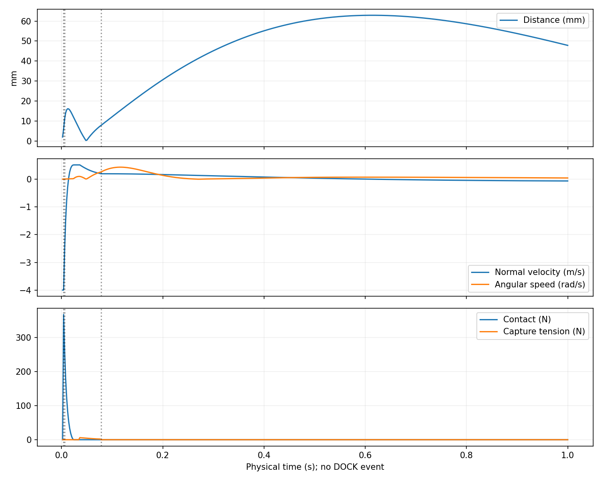
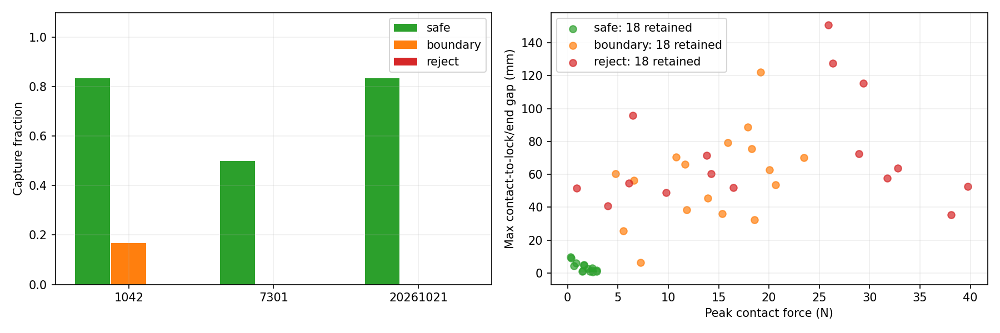

# 双四旋翼捕获力学、状态机与可复现性审计

日期：2026-10-21。基线为最新 main `176b02c8dc550578b2f2a2f64f9d33ec17447a06`，实现提交为 `123a2dd`、`cda30f2`，分支 `fix/capture-physics-audit-20261021`。开发在独立 worktree 中完成；原工作区未提交的 CAD、截图、生成脚本和历史实验均未覆盖。SE(3) 控制器、组合体动力学、八电机分配器及 MJCF 几何文件没有改动。

本轮完成了软件物理一致性和声明工况内的验收。硬件磁力、质量惯量、实际配合及碰撞材料参数仍未标定，不能据此宣称已验证制造机构或获得普遍成功率保证。

## 交付与复现入口

可移植证据位于 [capture_audit_20261021](capture_audit_20261021/)，含全部 71 个新实验工况的 500 Hz 关键字段 CSV 压缩投影、完整事件前后状态 JSON、配置、原始文件 SHA256、逐项测试状态、图和动画。投影不降采样、不舍弃失败工况；完整所有列 CSV 留在新的本机实验目录：

`/home/ubuntu22/Downloads/dual_uav_capture_fix/results/capture_audit_20261021/`

最终数据是 `validated_study/`、`deterministic_repeats/` 和 `final_regression/`；其他子目录为保留的中间诊断，不能混作最终结果。原始 CSV 路径和哈希见 [catalog.json](capture_audit_20261021/data/catalog.json)。[manifest.json](capture_audit_20261021/manifest.json) 的源码哈希与最终运行源码逐一相符。

```bash
cmake -S core -B core/build -DCMAKE_BUILD_TYPE=Release
cmake --build core/build -j4
PYTEST_DISABLE_PLUGIN_AUTOLOAD=1 python3 scripts/validate_stage2.py --skip-build --output results/capture_regression_NEW
python3 scripts/validate_capture_audit.py --output results/capture_study_NEW --seeds 20261021 1042 7301 --samples-per-class 6
python3 scripts/run_pair_collision_experiment.py --output results/pair_collision_NEW.json
python3 scripts/audit_cad_mujoco.py --output results/cad_audit_NEW.json
python3 reports/capture_audit_20261021/verify_records.py
```

随机试验入口拒绝覆盖已有目录。CAD 审计可重复传 `--cad`，以同时检查已提交版本与另一个现有 FCStd。未执行 CAD 建模脚本或宏，未重建原生模型。

环境：Ubuntu 22.04、Python 3.10.12、MuJoCo 3.16.0、NumPy 1.26.4、GCC 11.4、CMake 3.25.2。完整版本见 manifest。旧提交自带二进制也被重新编译核查：重编译后的基线名义 CSV 与原自带库输出逐字节相同，见 [证明](capture_audit_20261021/baseline_rebuild_comparison.json)。

## 根因与实际修改

| 问题 | 根因 | 修复与证据 |
|---|---|---|
| 接触历史永久有效 | `has_contacted` 首次置位后不随脱离复位，允许无新接触重新吸附 | 分开实际接触、40 ms 确认保持、有限行程机构接合、脱离、锁定及主动释放；脱离后必须有当前真实接触才能重新接合 |
| 接触点重合退化 | 以两 site 差归一化；穿过零点时拉力方向翻转 | 在接触面后各 4 mm 设牵引锚点，沿锚点中心连线施力，力实际作用在这些锚点 |
| 参数含义混淆 | 6 N 被称为最大静态吸附力，实际静态上限仅 0.84 N | YAML 改名 `max_resultant_force_N`，保留旧键读取兼容；分开静态、有效阻尼、合力、功率和储能日志 |
| 接合能量来源不清 | 每次启用力场不能被视为免费充能 | 使用有限内部预充能库；接合转移储能、脱离回收剩余储能、锁定耗散剩余储能，均不改 qpos/qvel |
| 锁定无需机构接合 | 20 mm 运动学容差内的边缘接触可绕过 6 mm 机构行程直接 weld | 锁定同时要求机构已接合；新增 10 mm 错位、真实接触但不得锁定的回归；独立审计检查 DOCK 前机构状态 |
| 驻留并非连续合格 | 旧滞回保留、缓慢衰减驻留，短时失联/超速可继承信用 | 全部严格判据连续满足 30 ms；物理步上的不合格也清零驻留；几何滞回仅用于机构是否仍接合 |
| 锁定关闭第三方碰撞 | 清零 Q2 pad 的全部碰撞位掩码 | 两个保留位编码精确成对兼容关系；第三方原有兼容关系逐对保留，无全局回调或全机碰撞关闭 |
| 重复试验与初始夹具 | 组合控制惯量、扰动后的质量/惯量/接触参数及预连接应用顺序可残留 | 每轮恢复名义模型和控制状态，再施加本轮扰动；初始位姿/预载先应用，再冻结预连接参考；复用与新建 runner 逐样本相同 |
| 事件时间语义 | 未释放的反事实实验也填写释放时间；切换前特征与切换后启用未分开 | 干预时刻与真实 UNDOCK 分列；先提取事件前特征，物理切换成功后启用补偿；完整 FSM_TRANSITION 和事件快照 |
| 编译环境隐患 | Git 跟踪绝对路径 CMake 缓存、平台二进制及旧产物 | 移除生成物的版本跟踪并忽略 core/build；原诊断 JSON 完整移至 reports/archive，原工作区文件保留 |

## 捕获力、方向与能量推导

仿真单位为 SI，世界 Z 向上、机体 FLU。令两接触点为 p1、p2，b=0.004 m；机体旋转为 R1、R2，ey 为机体 Y 轴：

```
a1 = p1 - b R1 ey           a2 = p2 + b R2 ey
L = ||a2-a1||               n = (a2-a1)/L
g = max(L-2b, 0)            v = (va2-va1)·n
Fs = min(Fmax, k max(dc-g,0))
F  = clip(Fs + c v, 0, Fmax)
Fd = F - Fs
```

n 从 Q1 锚点指向 Q2，v>0 表示锚点分离；Q1 受力 `+F n`，Q2 受力 `-F n`。阻尼对称使用 c=10 N·s/m，并在合力空间实施单向拉力限幅。旧模型的闭合方向 0.5 倍阻尼改为同一物理 dashpot；k=140 N/m、dc=6 mm、合力限幅 6 N 均未增大。实际角阻尼配置原本就是 0.08 N·m·s/rad，本轮未按旧文字中的 0.04 擅改。

角阻尼自由力偶为 `tau1=clip(Cw*(omega2_world-omega1_world),±0.2 Nm)`、`tau2=-tau1`。它耗散相对转动，不能被解释为静态姿态对准弹簧。锚点速度包含机体转动产生的点速度，`mj_applyFT` 负责正确的作用点力矩和自由关节坐标转换。

进入包络为 site 距离≤6 mm、姿态差≤0.15 rad；已接合后的释放包络为其 1.25 倍。该包络内：

`L >= 2b cos(1.25*0.15/2) - 1.25*0.006 ≈ 0.465 mm > 0`。

所以 site 重合处仍有明确的有限轴，不使用任意世界轴补丁。完全对齐时没有多余力矩。总内力为零；关于世界原点的总内力矩为 `(a1-a2)×(F n)+tau1+tau2=0`。仅把力改沿机体轴、却仍施加在两个横向错位 site 上，会破坏此性质，因此这里连作用点也一致修改。

定义牵引元件势能 `U(L)=∫[0,L] Fs(s) ds`，则 `dU/dt=Fs*v`。未达到静态限幅时：

```
U = k dc L                                      L <= 2b
U = 2b k dc + k dc g - 0.5 k g²                 0 <= g <= dc
Umax = 2b k dc + 0.5 k dc² = 0.00924 J           g >= dc
```

初始有限库能量为 Umax。接合时从库中转移当前 U，库不足则拒绝接合；脱离时回收剩余 U；锁定时把剩余 U 计入耗散。该理想内部储能/离合机构是明确的仿真假设，未冒充硬件磁场；没有每次碰撞免费追加能量。

在连续运动段：

`d(K+U)/dt = -Fd*v - tau1·(omega2_world-omega1_world) <= 0`。

分离时 Fd≥0；闭合时 Fd≤0，即使拉力被截到零，阻尼项也不会成为能量源。总账为 `K+U+E_reservoir+D+E_discarded`；事件只转移或耗散内部储能，不引入速度重置。

### 0.84 N、6 N 与实际捕获能力

- 静态上限：`k dc = 0.84 N`，不是 6 N。
- 阻尼：未限幅时为 c*v；6 N 限制的是静态与阻尼的合力。在 g=0 时，分离速度约 0.516 m/s 才到合力上限。
- 仅考虑 0–6 mm 正间隙的静态牵引，最大阻止分离功为 `0.5 k dc²=0.00252 J`。两机各 1 kg 的约化质量为 0.5 kg，对应约 0.1004 m/s 的一维静态能量尺度；这不是有接触、姿态耦合和控制器时的成功保证。
- 实际能力还取决于接触软约束、角运动、控制参考和有限驻留。不能仅由四个参数推导 2.62 mm 反弹或 0.324 s 锁定延迟。

## 真实名义数据与独立物理实验

| 同一基线场景、同一指标窗口 | 基线重编译 | 修复后 |
|---|---:|---:|
| 首次 CONTACT / s | 2.722 | 2.722 |
| DOCK / s | 3.046 | 3.056 |
| CONTACT→DOCK / s | 0.324 | 0.334 |
| CONTACT 至 DOCK 前最大 site 距离 / mm | 2.62258 | 2.61104 |
| 引擎连接垫接触峰 / N | 31.53636 | 31.53636 |
| 捕获合力峰 / N | 1.03686 | 1.03949 |
| 锁定后 [DOCK+0.1,UNDOCK) 最大 site 距离 / mm | 0.37770 | 0.36646 |
| 同窗口绝对相对姿态峰 / rad | 0.02036 | 0.01975 |

本次重跑复现了历史 2.62 mm 和 0.324 s 两个数值，但不复用历史报告中未在此 commit/窗口复现的 0.07 mm、0.00004 rad 等指标。保持物理门槛后延迟增加 10 ms，不以参数调优补回。

新模型名义静态牵引峰约 0.7883 N，有效阻尼范围约 [-0.6882,0.3799] N，远未用到 6 N 合力上限。捕获阻尼累计耗散约 4.751 mJ；接合内部储能转移约 8.138 mJ，锁定剩余储能耗散约 7.015 mJ，能量来源与阻尼耗散分列，不能相加后称为碰撞损失。

首次接触时相对线速度约 0.3693 m/s、姿态差 0.12134 rad，锁定判据不合格。CAPTURE_READY 在 3.026 s：距离 0.468 mm、线速度 0.00351 m/s、角速度 0.19816 rad/s；随后连续驻留 30 ms，于 3.056 s 锁定。延迟主要包含接触后的角运动衰减与重新对准等待，不能把 CONTACT 等同 DOCK。

十次 ±0.9 mm 确定性初值偏移回归均捕获成功；补充保存的十次记录中 CONTACT→DOCK 都为 0.334 s，量化标准差为零。这是确定性回归，不是蒙特卡洛成功率证据。

独立牵引实验使用原生刚体、零重力、零电机，在 t=0 真实接触确认后隔离接触约束，以单独检查内部牵引元件。该实验夹具中的接触隔离没有用于飞行场景。动量和动能由原生刚体状态独立求和，没有重复捕获力公式冒充守恒验证。

| 实验 | 最大线动量残差 kg·m/s | 最大角动量残差 kg·m²/s | 能量账最大超额 J |
|---|---:|---:|---:|
| 仅阻尼，dt=0.5 ms | 2.78e-17 | 2.01e-9 | 3.24e-6 |
| 有限牵引，dt=0.5 ms | 6.25e-17 | 9.92e-9 | -1.22e-7 |
| 有限牵引，dt=0.25 ms | 5.55e-17 | 4.94e-9 | -3.05e-8 |

仅阻尼的动能从 0.00164023 降到 0.00102246 J；记录的阻尼功率均≤0。有限牵引实验动能可以增加，但来自储能下降；细化步长后角动量残差约减半。耗散积分采用步内保持的功率，存在表中微焦耳级离散积分误差，未宣称数值上精确能量守恒。详细 CSV 和账本见 [independent_physics.json](capture_audit_20261021/independent_physics.json)。





## 失败、再次尝试与碰撞过滤

1.6 m/s 初始相对接近速度的真实碰撞在 0.008 s 首次接触，没有立即锁定；经历真实接触减速、对准和连续驻留后在 0.086 s 合法锁定。4 m/s 工况在 0.004 s 接触，0.006 s 和 0.078 s 两次脱离机构包络，1 s 观察期内未锁定；最大接触后距离约 62.9 mm、接触峰约 367.97 N、牵引合力达到 6 N 限幅。相对角速度 4 rad/s 和 38 mm 边缘擦碰工况也真实失败。没有瞬移、强制速度清零或强制连接。

有驱动力的独立双次尝试实验用真实外加伺服力反向接近，第一次高速失败后第二次重新接触、接合并成功；实验过程没有运行时写入 qpos/qvel。随机边界中曾出现“第二次接触满足宽位置容差但机构未接合”的情况，最终版本正确拒绝，不把该事件包装成成功。

MuJoCo 按 `(contype1 & conaffinity2) || (contype2 & conaffinity1)` 判断动态碰撞兼容。实现预先保留第三方的原始兼容决策，再分配两个未占用位表示连接垫；LOCKED 只去掉这两个垫之间的兼容边，UNDOCK/RESET/ABORT 恢复该边。没有注册会影响其他模型的全局 callback。显式 `<contact><pair>` 会绕过位过滤，若为受管理垫对则明确报错。[官方碰撞规则](https://mujoco.readthedocs.io/en/stable/computation/index.html#collision-detection) 支持此设计。

第三方球体的独立原生引擎夹具实测：锁定时两垫互相接触消失，但 Q2 垫与障碍物仍有约 30.295 N 接触力；释放和 RESET 后原垫对接触恢复。完整记录见 [pair_collision_experiment.json](capture_audit_20261021/pair_collision_experiment.json)。第三方兼容性还通过所有 geom 两两矩阵比对，以及真实接触测试验证。



[修改前后对接及分离对照 MP4](capture_audit_20261021/videos/before_after.mp4) · [对照 GIF](capture_audit_20261021/videos/before_after.gif) · [高速失败 MP4，4 倍慢放](capture_audit_20261021/videos/high_speed_failure.mp4)

动画回放实际保存的 qpos，时间、模式、距离和接触力来自 CSV；没有为画面重新生成轨迹。最终名义/高速失败 CSV 与生成动画所用 CSV 逐字节相同。

## 固定种子的随机与边界统计

在运行前固定分类及全部输入，种子为 **20261021、1042、7301**，每种子每类 6 次，共 54 次。变动包括相对位置、三轴相对速度、roll/pitch/yaw、相对角速度、接触有效刚度/阻尼 0.8–1.2 倍、牵引 k=112–168 N/m、c=8–12 N·s/m、电机 18–32 ms 响应及 0–6 ms 延迟、两机质量 ±3%、惯量各轴 ±4%。控制器保持名义参数，从而形成实际模型失配。

接触随机化改变的是求解器有效刚度/阻尼比例，不是实物材料常数。正格式 solref 下通过 `tau'=tau/b_scale`、`zeta'=zeta*b_scale/sqrt(k_scale)` 实现；两个垫同步改变，保留每轮实际 solref。[MuJoCo solref 定义](https://mujoco.readthedocs.io/en/stable/modeling.html#reference) 说明其约束空间含义。

| 预先分类 | 捕获/总数 | 捕获率 | 观测误锁 | 异常/提前终止 | 成功样本接触至锁定均值 |
|---|---:|---:|---:|---:|---:|
| A 预期安全 | 13/18 | 72.22% | 0 | 0/0 | 31.69 ms，13 个可观察值 |
| B 边界 | 1/18 | 5.56% | 0 | 0/0 | 206 ms，1 个可观察值 |
| C 明确拒绝 | 0/18 | 0% | 0 | 0/0 | 不可用 |

最终误锁审计同时检查：DOCK 前机构已接合、当前/短时保持的真实接触、全部严格运动学条件，以及此前连续 30 ms 的物理步记录。早期审计只检查运动学，曾把三个未进入机构行程的锁定计作成功；该实现缺口已经修复，最终统计不沿用中间结果。

安全组 5 次失败中，3 次未实际接触，另 2 次没有建立/维持有效机构接合；完整工况保留。安全组命名表示采样设计意图，不构成已证明的吸引域，后续需要独立改进接近策略。没有将这些失败自动标成程序错误，也没有通过提高力或放宽门槛使其成功。

随机组最大接触峰：安全 2.896 N、边界 23.492 N、拒绝 39.731 N。最大接触后距离分别约 9.90、122.03、150.90 mm；未接触时该指标为 null。成功样本最大 weld 锚点误差：安全 9.14 µm、边界 6.93 µm；姿态约束误差分别 0.00285、0.00976 rad。八电机命令变化率均≤45 N/s（浮点误差约 1e-13），随机组观测饱和占比为零。约束载荷及各工况完整指标见 [统计 CSV](capture_audit_20261021/figures/trial_statistics.csv) 与 [summary.json](capture_audit_20261021/summary.json)。

weld 误差相对实际捕获参考定义；site 间隙并不因此被强制为零。随机成功样本锁定后的最大 site 距离约 5.993 mm，不能拿微米级 weld 残差冒充同等精度的机构配合，见 [locked_geometry.csv](capture_audit_20261021/locked_geometry.csv)。本轮零观测误锁不能排除未覆盖条件下的罕见错误。



## CAD / MuJoCo 尺寸与坐标审计

只读取两个现有 FCStd 的持久化 XML 参数及放置，不调用 FreeCAD Python 建模、不执行生成脚本、不用视觉 mesh 替代接触模型。缺少 CADPilot 结构化测量连接，因此 BREP 有效性、实体体积和制造级最小间隙未重新认证。参数扫掠包络不冒充 BREP 测量。

| 项目 | 已提交 CAD | 原工作区未提交的新 CAD | MuJoCo |
|---|---|---|---|
| 文件 SHA256 前缀 | 9ca4cb482a6a | 1bbf79901a0c | MJCF 源哈希见 manifest |
| 原生 Body 数 | 18 | 26 | 两个独立自由刚体 |
| 参数扫掠外廓 / mm | 372×372，高 87 | 378×378，高 127.84 | 中心机身盒 160×160×60 |
| CAD 框架本体 | 370×370 mm | 370×370 mm | 视觉盘外廓 X≈360.42 mm，单侧垫使 Y≈400.21 mm |
| 电机中心 XY / mm | ±106.066 | ±106.066 | ±120.20815 |
| 接口参数 | Y=±180 的竖直环支架，外缘约 ±186 | 六个 Φ12、厚 3 磁体/面，外表面 Y≈±189；中心 Z=24/39 | 面在 Y=±220，site Z=0；40×20×40 方垫 |
| 连接面方向 | 未给出有效水平装配面/持久配合 | 向外 ±Y；CAD Z 零点在底板 | Q1 +Y、Q2 -Y；机体系原点假设为 COM |

相同原点、同向且面相贴的参数推算：新 CAD 磁体外表面对应两机原点间距约 **378 mm**，旧环外缘候选约 **372 mm**；两者均未提供真实装配 mate。MuJoCo 名义为 **440 mm**，本轮名义锁定瞬间实际质心距离约 **440.344 mm**。由于 CAD→机体 FLU/COM 的刚体变换未标定，不能把 CAD 的 Z=24/39 直接与仿真 site Z=0 比较后宣称已经对齐。

若按 README 的 5.1 英寸盘径 129.54 mm、同高平行盘假设，新 CAD 在 378 mm 原点间距下，跨机盘间最小参数间隙约 **36.328 mm**；沿用仿真 440 mm 间距则约 **98.328 mm**。MuJoCo 半径 60 mm 的视觉盘在 440 mm 名义间距下，跨机间隙约 **79.584 mm**。这些是声明盘参数的几何推算，不含倾转扫掠、桨挠曲或制造公差。

仿真每机质量 1 kg、惯量 diag(0.0082,0.0082,0.0145) kg·m²。CAD 材料密度、实际设备质量、质心与惯量未验证；新的上层计算机和电池布置尤其不能视为已包含在真实惯量中。接触位置也与六圆盘/环支架不同，方垫没有表达真实磁极、导向、局部接触或装配柔性。

新 FCStd 记录 39 个草图，约束列表均为零；未重算 DOF，也不宣称满足完全约束要求。README 的 Body 数和“完全参数化”描述不能替代本次原生拓扑/约束认证。本轮按要求报告差异，未擅改 CAD 或控制模型几何。完整证据见 [cad_audit.json](capture_audit_20261021/cad_audit.json)。

## 日志、测试与后续接口

CONTACT 为每次实际垫对接触开始，带 collision_index；CAPTURE_START 表示有限行程机构接合，带 attempt_id；CAPTURE_READY 是严格判据开始驻留；DOCK 才是 weld 生效。另有 CAPTURE_FAILED、CAPTURE_DWELL_RESET、RELEASE_PREP、UNDOCK、ABORT、FSM_TRANSITION。主动释放后不会凭恢复的面接触立即重新锁定。

名义时刻依次为 CONTACT/CAPTURE_START=2.722、再次 CONTACT=2.962、CAPTURE_READY=3.026、DOCK=3.056、RELEASE_PREP=5.006、UNDOCK=5.110 s。记录精度受 2 ms 物理步限制，不冒充连续碰撞求根时刻。每次切换前后保存 qpos/qvel、电机状态及机构状态；JSON 记录精确网格时刻，CSV 首个新模式行在下一物理步。

接触力由 mj_contactForce 提取；weld 载荷只取对应 equality 行，分别输出力和力偶，不对混合广义向量赋单一牛顿单位。累计正法向力积分包含持续接触，不能称为纯冲击冲量。当前状态的力与前一积分步保持的力分列。姿态误差相对当时活动控制参考；组合模式下单机参考导数明确无效。反事实 weld-kept 只记录 INTERVENTION，不伪造 UNDOCK 或提前启用分离补偿。

[独立 CSV/JSON 重建](capture_audit_20261021/record_verification.json) 对 71 个工况、86,600 行、528 个事件逐一核对：模式错位 0、非法锁定 0、事件瞬时 qpos/qvel 改动 0。所有工况原始记录和异常路径均保留。

| 验证 | 基线 | 最终 |
|---|---:|---:|
| Python 全套，包括原 T1–T9 | 105 PASS | **129 PASS** |
| C++ 原生/研究测试 | 22 PASS | **23 PASS**，两套 CTest 程序均通过 |
| 原有独立碰撞/释放实验 | — | **3/3 PASS** |
| 原有 P0/P1 六闭环场景 | — | **6/6 PASS** |
| 新独立捕获能量/动量实验 | — | **3/3 PASS** |
| 新建与复用 runner、随机种子、事件接口、碰撞恢复 | — | 纳入 129 项测试，全部 PASS |

逐项状态见 [Python](capture_audit_20261021/python_test_status.json)、[C++](capture_audit_20261021/cpp_test_status.json)、[P0/P1](capture_audit_20261021/p0_p1_summary.json)。

旧测试物理假设的修改有明确原因：T4/P0 的 30 mm **目标**偏移会出现真实接触并合法捕获，因此保留为新边界工况，另以实际未接触的 60 mm 目标偏移验证拒绝；没有删除“不满足条件不得锁定”的断言。T7 改为检查原始碰撞兼容关系恢复，并新增真实第三方碰撞，替代对掩码整数必须为 1 的实现假设。T8 保留十次回归并明确其确定性；随机试验单独设计。锁定时间、误差等其他门槛没有为提高通过率放宽。

`mujoco_sim/python/event_interfaces.py` 提供已验证接口：

- `event_feature_extractor`：仅从事件 pre 状态生成不可变 42 维包，含 14 qpos、12 qvel、8 实际/8 目标推力；不读取事件后结果或载荷 oracle。
- `event_response_recorder`：每个发生次数独立的有限时域响应，标记不完整窗口，保留捕获失败。
- `event_metrics`：复用活动参考 SO(3)、位置、角速度、恢复/截尾及控制代价指标。
- `LearningControllerInterface` / `CausalMotorCompensation`：统一 reset、on_event、八电机补偿接口；事件前输出严格为零，最终仍经过公共电机限幅/变化率链。

新的 `event_pre_state_v1` 包与既有 32 维 `ResearchPolicy` 特征协议分开命名，不能直接混用；既有策略也增加了“切换前准备、切换成功后启用”边界。未训练 PPO、ILC 或 ECLR，未调整学习奖励、未作算法优势比较，未修改 PX4 或引入 Gazebo。

## 尚未解决的限制

安全随机组仍有 5/18 未捕获，边界组只有 1/18 成功；需在另一个独立任务中研究接近轨迹与硬件容差，不能把本轮当成高可靠性统计认证。预充能库/理想离合和角阻尼是明确的集中参数假设，尚无真实锁扣力位移曲线支持。接触峰对软约束、步长和网格接触生成敏感；367.97 N 不是经过实物验证的冲击载荷。

CAD 的装配面、COM 注册、质量惯量和草图约束未完成验证；方垫与六磁体接触的差异未消除。本轮没有大规模重建 CAD。随机模型失配目前为小范围、短时近接触试验，不能外推为完整任务、气动干扰或真机结果。旧 contact_analysis 回放用于历史协议；新运行按 FSM_TRANSITION 和本报告的独立验证器重建，不能套用旧滞回驻留假设。

本轮物理验收接受合理条件下捕获和不合格条件下失败，同时明确保留上述负结果与未验证参数。
