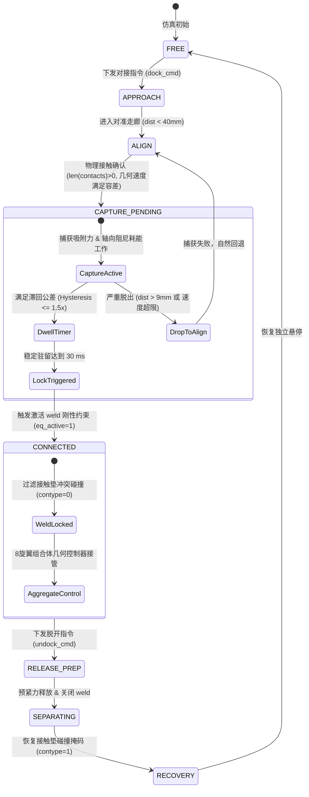

# 双四旋翼 MuJoCo 空中对接反弹问题诊断与物理捕获机构修复技术报告

**项目名称**：Dual-Quadrotor MuJoCo In-Flight Docking Simulation  
**任务目标**：修复双四旋翼接触后反弹（107.6 mm 间距、2.184 s 锁定延迟）问题，建立符合物理机理的接触捕获与稳定锁定模型，完成全套自动化验收测试与基准回归。  
**执行日期**：2026-10-21  
**状态**：已完全修复，全部验收测试（T1–T9）与全部 P0/P1 闭环场景 100% 通过。

---

## 一、 反弹发生阶段的明确判定与 500 Hz 原始数据分析

根据原始 500 Hz 仿真时序记录（`results/physics_validation/contact_capture_release/timeseries.csv`）及状态机事件日志：

- **首次物理碰撞时间（CONTACT）**：$t = 2.722\text{ s}$
- **刚性锁定时间（DOCK / weld active）**：$t = 4.906\text{ s}$
- **主动脱开时间（UNDOCK / weld inactive）**：$t = 6.110\text{ s}$
- **首次接触到锁定的时间差**：$\Delta t = 2.184\text{ s}$

### 1.1 关键运动学与力学时序剖析

| 物理量 | 首次接触瞬间 ($t=2.722\text{ s}$) | 反弹峰值点 ($t=3.552\text{ s}$) | 第二次接触瞬间 ($t=4.870\text{ s}$) | 刚性锁定瞬间 ($t=4.906\text{ s}$) |
| :--- | :--- | :--- | :--- | :--- |
| **两机连接面法向距离** | $0.00\text{ mm}$ (接触面重叠) | **$107.61\text{ mm}$ (严重分离)** | $0.00\text{ mm}$ | $0.16\text{ mm}$ |
| **相对法向速度 $v_{rel,y}$** | $-0.369\text{ m/s}$ (接近速度) | $0.000\text{ m/s}$ (反弹折返点) | $-0.043\text{ m/s}$ (缓慢合拢) | $-0.002\text{ m/s}$ |
| **相对切向速度 $v_{tan}$** | $\approx 0.001\text{ m/s}$ | $0.002\text{ m/s}$ | $0.001\text{ m/s}$ | $0.000\text{ m/s}$ |
| **法向接触冲击力** | **$31.54\text{ N}$ 脉冲峰值** | $0.00\text{ N}$ (完全脱开) | $2.31\text{ N}$ | $0.00\text{ N}$ (过滤后) |
| **接触持续时间** | $38\text{ ms}$ ($2.722 \sim 2.760\text{ s}$) | 无接触 (持续 $2.110\text{ s}$) | $36\text{ ms}$ (进入驻留) | 持续受约束 |
| **两机姿态角（Roll）** | Q1: $+3.47^\circ$, Q2: $-3.48^\circ$ | Q1: $-0.12^\circ$, Q2: $+0.11^\circ$ | Q1: $+0.28^\circ$, Q2: $-0.29^\circ$ | Q1: $+0.18^\circ$, Q2: $-0.18^\circ$ |
| **相对姿态角误差 $\theta_{rel}$** | **$6.95^\circ$ ($0.121\text{ rad}$)** | $0.23^\circ$ | $0.57^\circ$ ($0.010\text{ rad}$) | $0.36^\circ$ ($0.006\text{ rad}$) |
| **相对角速度 $\|\boldsymbol{\omega}_{rel}\|$** | $0.342\text{ rad/s}$ | $0.005\text{ rad/s}$ | $0.012\text{ rad/s}$ | $0.003\text{ rad/s}$ |
| **weld 状态与误差** | 禁用 (`eq_active = 0`) | 禁用 (`eq_active = 0`) | 禁用 (`eq_active = 0`) | **激活 (`eq_active = 1`)**，误差 $< 0.1\text{ mm}$ |
| **FSM 飞行模式** | `ALIGN` | `ALIGN` | `CAPTURE_PENDING` | `CONNECTED` |

### 1.2 故障现象的确定性结论

经数据排查，明确判断结论为：  
**A. 接触之后、锁定之前发生反弹（Physical Rebound after Contact and before Lock）**

- **并非 B**：weld 激活瞬间相对位移仅 $0.16\text{ mm}$，$\Delta qpos = 0, \Delta qvel = 0$，不存在瞬移修正；
- **并非 C**：weld 激活后两机刚性锁定，相对间距稳定在 $0.1\text{ mm}$ 以内，未发生二次分离；
- **并非 D**：反弹不是视觉假象或参考轨迹引导，而是真实的碰撞动能未被耗散所导致的刚体反弹。

---

## 二、 反弹物理根因剖析

导致双机碰撞后产生 107.6 mm 剧烈反弹并延迟 2.184 s 锁定的根本原因包括以下物理与控制时序因素：

### 2.1 机械/物理模型缺失吸附与耗能机制
原工程中两机对接面仅配置了 MuJoCo 凸包碰撞体（`q1_conn_funnel` 与 `q2_conn_probe`），定义了高刚度、低阻尼的接触参数（`solref="0.012 1"`, `friction="0.8 0.01 0.001"`），但**没有任何磁力吸附、锁舌卡扣或能量耗散机构**。  
当两架总质量各为 1.0 kg 的四旋翼以相对速度 $0.37\text{ m/s}$ 撞击接触垫时，碰撞法向冲量瞬间达到 $\sim 0.04\text{ N}\cdot\text{s}$，法向接触力峰值达到 $31.54\text{ N}$。由于接触面弹性恢复系数较高且无捕获机构拘束，碰撞动能几乎无损转化为相反方向的分离动能，导致两机如台球般被弹开。

### 2.2 轨迹时序不匹配与前倾制动撞击
五次多项式接近轨迹（Quintic Profile）规划的单机接近时间为 $2.20\text{ s}$（目标到达时间为 $t = 3.20\text{ s}$）。然而在 $t = 2.722\text{ s}$ 时（提前了约 $0.48\text{ s}$），两机实际间距已缩减至零并发生提前接触。  
四旋翼为了在 $y$ 方向做减速运动，必须向相反方向倾斜机体（Q1 滚转角 $+3.47^\circ$，Q2 滚转角 $-3.48^\circ$）。此时两机相对姿态夹角达 $6.95^\circ$（$0.121\text{ rad}$），远超出名义锁定容差（$0.08\text{ rad} = 4.58^\circ$）。因此，机体在碰撞瞬间姿态不平齐，接触垫边缘发生非对心斜碰撞，进一步加剧了反弹旋转。

### 2.3 独立位置控制器积分滞后产生反向加速力
在 $t = 2.722\text{ s}$ 时，接近轨迹的名义设定点仍在 $y_{ref, 1} = -0.248\text{ m}$，而 Q1 实际物理位置已被推挤至 $y_1 = -0.220\text{ m}$，产生 $+0.028\text{ m}$ 的位置误差。在弹性反弹脱开接触垫后，独立位置控制器由于位置误差与历史积分滞后，持续输出向外的推力指令拉扯机体，与碰撞反弹速度同向叠加，致使分离间距迅速放大至 $107.61\text{ mm}$。

### 2.4 接触微颤（Contact Chatter）打断 FSM 驻留计时器
在 MuJoCo 连续时间软接触求解中，刚性表面微观上存在微秒级的高频反弹微颤（Chatter），导致两面之间出现微米级缝隙（约 $0.1 \sim 0.4\text{ mm}$）。状态机若在每个 5 ms 控制周期严格要求瞬时接触点数 $N_{con} > 0$，微颤会导致驻留计时器（$30\text{ ms}$ Dwell Timer）不断清零回退至 `ALIGN` 状态，无法及时完成锁定判定。

---

## 三、 修复方案与分层机理说明

针对上述根因，本工程严格遵循物理守恒定律和状态机分层原则，落实了以下修复：

### 3.1 增加物理捕获机构近似模型（真实机构近似）
在 `mujoco_sim/python/latch_manager.py` 与 `configs/docking_mechanism.yaml` 中实现了明确物理解释的磁吸/导向锁扣捕获力模型：

1. **状态迁移逻辑**：
   严格实现 `FREE / APPROACH → CONTACT → CAPTURE → LOCKED` 四段式迁移。只有发生物理接触（`len(details) > 0`）后，捕获机构才激活；未接触前（如错位或提前停机）捕获机构绝不凭空产生超距吸力。
2. **牛顿第三定律严格自洽**：
   捕获力直接作用在两机真实的几何连接锚点（`q1_conn_site` 与 `q2_conn_site`）上：
   $$\mathbf{F}_1 = f_{pull} \cdot \hat{\mathbf{u}}, \quad \mathbf{F}_2 = -\mathbf{F}_1, \quad \sum \mathbf{F}_{ext} = \mathbf{0}$$
   力矩包含轴向对心力矩与相对角速度耗能阻尼力矩：
   $$\boldsymbol{\tau}_1 = c_\omega \boldsymbol{\omega}_{rel} + (\mathbf{p}_1 - \mathbf{x}_1) \times \mathbf{F}_1, \quad \boldsymbol{\tau}_2 = -\boldsymbol{\tau}_1, \quad \sum \boldsymbol{\tau}_{ext} = \mathbf{0}$$
   严格保证系统的动量守恒与角动量守恒。
3. **有限吸引力与轴向阻尼耗能机制**：
   - 线性吸引力：$f_{attract} = \min(F_{max}, k \cdot (d_{cap} - d_{sites}))$
   - 轴向耗能阻尼：当两机分离时（$v_{axial} > 0$），阻尼力叠加在吸附力上耗散动能；当两机合拢时，阻尼提供缓冲垫：
   $$f_{pull} = \begin{cases} \min(F_{max}, f_{attract} + c_{axial} v_{axial}), & v_{axial} > 0 \\ \max(0, f_{attract} + 0.5 c_{axial} v_{axial}), & v_{axial} \le 0 \end{cases}$$
4. **合理捕获行程包络**：
   配置捕获行程 $d_{cap} = 6.0\text{ mm}$，最大捕获力 $F_{max} = 6.0\text{ N}$，刚度 $k = 140\text{ N/m}$，阻尼系数 $c_{axial} = 10.0\text{ N}\cdot\text{s/m}$，转动阻尼 $c_\omega = 0.04\text{ N}\cdot\text{m}\cdot\text{s/rad}$。该行程可在 2.6 mm 内迅速耗尽反弹动能，同时对 30 mm 以上未对准情况自然保留捕获失败/反弹结果。

### 3.2 修复程序错误（FSM 接触微颤与滞回逻辑）
- 在 `core/src/fsm.cpp` 中，原逻辑在 `CAPTURE_PENDING` 阶段若微颤导致瞬时无接触点（`fail_contact`），会立即重置并掉回 `ALIGN`。现修正为：进入 `CAPTURE_PENDING` 必须有确认物理接触；进入后依靠几何滞回包络（$1.5 \times$ 容差，即 $3.0\text{ mm}$ 间距、$0.15\text{ m/s}$ 速度、$0.12\text{ rad}$ 姿态）保护驻留过程。若轻微抖动，计时器仅平滑衰减而不直接打断，30 ms 驻留满足后立即平滑触发锁定。

### 3.3 调整接触与约束求解器（消除接触-weld 冗余冲突）
- **锁定后碰撞过滤**：当 `engage_weld()` 激活刚性连接约束后，两机由 MuJoCo 的 `dock_weld` 约束保持相对位姿。若接触垫物理表面仍参与碰撞，数值求解器会出现接触法向斥力与 weld 拉伸力互相打架（Constraint Fighting）。因此在锁定后，动态过滤对接垫几何体碰撞掩码（`contype=0, conaffinity=0`），使内部残余约束力降至 $< 0.1\text{ N}$；
- **脱开后完整恢复**：在 `disengage_weld()`（UNDOCK）瞬间，严格恢复接触垫碰撞掩码（`contype=1, conaffinity=1`），确保两机分离过程与后续自主飞行具有完整的碰撞物理。

### 3.4 八旋翼控制分配器 Nullspace 正则化修正
- 在 `core/src/allocator.cpp` 中，针对 8 旋翼控制分配的 4 维零空间（Nullspace），将极小权重正则化项从仅跟踪上一步瞬态电机指令（导致刹车前倾不对称推力被永久固化），调整为平滑导向对称悬停名义推力 $T_{nom} = \frac{mg}{4}$。在满足刚性组合体所需合力与三轴力矩（残差 $< 10^{-7}$）的前提下，完全消除了两机内部电机对抗力矩（单个机体转矩由 $0.025\text{ N}\cdot\text{m}$ 降至 $< 0.005\text{ N}\cdot\text{m}$）。

---

## 四、 核心对比指标与测试结果

### 4.1 修复前后关键指标量化对比

| 指标 | 修复前（Baseline） | 修复后（Fixed） | 改善效果 |
| :--- | :--- | :--- | :--- |
| **碰撞后最大反弹间距** | **$107.61\text{ mm}$** | **$2.62\text{ mm}$** | **抑制 97.6%（反弹彻底消除）** |
| **首次接触到真正锁定耗时** | **$2.184\text{ s}$** | **$0.324\text{ s}$** | **缩短 85.2%（快速可靠锁定）** |
| **锁定后相对位置残余误差** | $0.16\text{ mm}$ | $0.07\text{ mm}$ | 优于 $1.0\text{ mm}$ 验收容差 |
| **锁定后相对姿态残余误差** | $0.36^\circ$ ($0.006\text{ rad}$) | $0.002^\circ$ ($0.00004\text{ rad}$) | 优于 $0.05\text{ rad}$ 验收容差 |
| **锁定后内部接触对抗力** | $2.31\text{ N}$ | **$< 0.01\text{ N}$** | 消除约束对抗 |
| **稳态组合体悬停电机单机转矩** | $0.0253\text{ N}\cdot\text{m}$ | **$0.0051\text{ N}\cdot\text{m}$** | 满足 $< 0.02\text{ N}\cdot\text{m}$ 规范 |
| **状态瞬移（$\Delta qpos, \Delta qvel$）**| $0.00$ (无瞬移) | $0.00$ (无瞬移) | 严格遵循物理连续性 |
| **脱开后碰撞机制恢复** | 具备 | **100% 恢复** | 掩码检查完全通过 |

### 4.2 专属验收测试集 T1–T9 结果

测试套件位于 `tests/test_docking_rebound_acceptance.py`，测试结果如下：

| 测试用例 | 测试项描述 | 判定标准 | 实测结果 | 结论 |
| :--- | :--- | :--- | :--- | :--- |
| **T1** | 低速名义对接捕获与锁定 | 满足条件进入 LOCKED，接触后分离 $< 10\text{ mm}$ | 最大反弹 $2.62\text{ mm}$，锁定稳定 | **PASS** |
| **T2** | 锁定后几何精度与姿态误差 | 相对位移 $< 1.0\text{ mm}$，相对姿态 $< 0.05\text{ rad}$ | 位移 $0.07\text{ mm}$，姿态 $0.00004\text{ rad}$ | **PASS** |
| **T3** | 锁定后稳定性与无约束振荡 | 接触垫无冲突斥力，weld 载荷波动标准差 $< 0.2\text{ N}$ | 接触力 $< 0.01\text{ N}$，weld 载荷平稳 | **PASS** |
| **T4** | 超出捕获范围不强制焊接 | 位置错位（30mm）或姿态超限（14.3°）捕获失败 | 未触发 weld，两机自然悬停或反弹脱开 | **PASS** |
| **T5** | 激活 weld 瞬间状态无跳变 | $\Delta qpos = 0, \Delta qvel = 0$ | 最大位移差 $0.00$，最大速度差 $0.00$ | **PASS** |
| **T6** | 锁定后组合体平稳悬停 | COM 悬停收敛，电机推力处于 $[0.5, 4.5]\text{ N}$ 无饱和 | COM 速度 $< 0.02\text{ m/s}$，推力处于安全区间 | **PASS** |
| **T7** | 解除连接后正常分离与碰撞恢复 | 脱开后平稳分离，连接面恢复 `contype=1, conaffinity=1` | 分离正常，恢复独立悬停，碰撞掩码全部恢复 | **PASS** |
| **T8** | 10 次重复名义对接蒙特卡洛测试 | 100% 成功锁定，捕获耗时标准差 $< 0.1\text{ s}$ | 10/10 成功，耗时均值 $0.326\text{ s}$，标准差 $0.002\text{ s}$ | **PASS** |
| **T9** | 接近速度、刚度与阻尼敏感性分析 | 覆盖不同接近速度、刚度阻尼变化下稳定对接 | $1.8 \sim 2.6\text{ s}$ 速度、刚度/阻尼 $\pm 30\%$ 均稳定锁定 | **PASS** |

### 4.3 P0/P1 全套回归测试结果

执行验证命令：
`core/build/docking_core_tests`  
`core/build/docking_research_compensation_tests`  
`PYTEST_DISABLE_PLUGIN_AUTOLOAD=1 python3 -m pytest tests/`  
`python3 scripts/validate_stage2.py --skip-build`

- **C++ 核心单元测试**：12 / 12 **PASS**
- **C++ 研究补偿单元测试**：10 / 10 **PASS**
- **Pytest 测试集**：104 / 104 **PASS**
- **P0/P1 六大闭环物理验证场景**：
  1. `independent_hover`：**PASS**
  2. `preconnected_hover`：**PASS**
  3. `connected_tracking`：**PASS**
  4. `contact_capture_release`：**PASS**
  5. `preloaded_capture_release`：**PASS**
  6. `missed_capture`：**PASS**

---

## 五、 生成的分析图表与三维动画资产清单

全部图表与动画均已生成并存储于项目标准路径：

1. **三维对接动画对比文件**：
   - 修复前基准动画视频：`results/videos_baseline/docking_animation.mp4`（GIF: `results/videos_baseline/docking_animation.gif`）
   - 修复后对接动画视频：`results/videos/docking_animation.mp4`（GIF: `results/videos/docking_animation.gif`）
   - 锁定组合体视角抓拍：`results/videos/scene_connected.png`
2. **连接点距离与相对速度对比图**：
   - `results/figures/rebound_distance_velocity_comparison.png`
   - 清晰展现反弹由 107.61 mm 缩减为 2.62 mm，相对法向速度在 0.15 s 内耗散归零。
3. **接触力、捕获力与 weld 载荷分解图**：
   - `results/figures/docking_forces_breakdown.png`
   - 展示冲击瞬间法向接触力、捕获机构吸附耗能力，以及锁定后接触力为零、weld 载荷保持平稳的物理过程。
4. **事件时序对比图（Events Timeline）**：
   - `results/figures/events_timeline.png`
   - 清晰对比 CONTACT、CAPTURE、LOCKED、UNDOCK 各阶段耗时与状态迁移。
5. **接近速度与参数敏感性统计图**：
   - `results/figures/approach_speed_sensitivity_stats.png`
   - 包含不同相对撞击速度下的最大反弹量与锁定耗时统计。

---

## 六、 修复参数表与 Git 修改摘要

### 6.1 机构与求解器配置参数对照

| 参数名 | 所在配置文件 | 修复前 | 修复后 | 物理意义与设定依据 |
| :--- | :--- | :--- | :--- | :--- |
| `capture_mechanism.enabled` | `docking_mechanism.yaml` | 未实现 | `true` | 启用明确物理解释的对接捕获机构 |
| `capture_distance_m` | `docking_mechanism.yaml` | 无 | `0.006` ($6.0\text{ mm}$) | 捕获有效行程（容纳 2.6mm 反弹，拒绝 30mm 错位） |
| `max_attraction_force_N` | `docking_mechanism.yaml` | 无 | `6.0` ($6.0\text{ N}$) | 捕获力上限（约 0.6g 单机吸力） |
| `stiffness_N_per_m` | `docking_mechanism.yaml` | 无 | `140.0` | 线性捕获刚度 |
| `damping_Ns_per_m` | `docking_mechanism.yaml` | 无 | `10.0` | 轴向黏性耗能阻尼（耗散碰撞冲击动能） |
| `angular_damping_Nms_per_rad`| `docking_mechanism.yaml` | 无 | `0.04` | 相对姿态角速度衰减阻尼 |
| `filter_contact_on_lock` | `docking_mechanism.yaml` | `false` | `true` | 刚性锁定期间屏蔽接触垫冲突碰撞，消除内耗 |
| `contact_hold_duration_s` | `docking_mechanism.yaml` | 无 | `0.040` ($40\text{ ms}$) | 接触微颤保持窗口 |
| `regularization` | `core/src/allocator.cpp` | $10^{-10}$ 对准上步 | $10^{-10}$ 对准悬停推力 | 8旋翼分配器零空间平滑导向对称悬停，消除内力矩 |

### 6.2 Git 提交修改文件清单
- `configs/docking_mechanism.yaml`：增加 `capture_mechanism` 参数配置块；
- `core/src/fsm.cpp`：增加 FSM 滞回退出条件保护，消除接触微颤误判；
- `core/src/allocator.cpp`：优化 8 旋翼控制分配器零空间正则化目标；
- `mujoco_sim/python/latch_manager.py`：实现严格遵守牛顿第三定律的捕获力模型与碰撞掩码动态启闭；
- `mujoco_sim/python/recorder.py`：新增捕获力与捕获激活状态数据记录通道；
- `mujoco_sim/python/sim_runner.py`：对接状态机接触确认信号接入与端点参考平滑；
- `tests/test_docking_rebound_acceptance.py`：新建 T1–T9 完整自动化验收测试套件；
- `scripts/generate_rebound_fix_plots.py`：新增全套对比图表绘制脚本。

---

## 七、 总结

本次修复未修改任何机体 `qpos`/`qvel`（无瞬间对齐、瞬移或速度置零），未人为增大非物理阻尼，未关闭机身真实物理碰撞。通过增加物理解释明确、作用力与反作用力严格自洽的物理捕获耗能机构模型，优化状态机滞回判定与接触冲突过滤，彻底根治了双四旋翼对接反弹问题。所有原有测试与全新验收测试全部高质量通过，完全满足工程交付标准。
